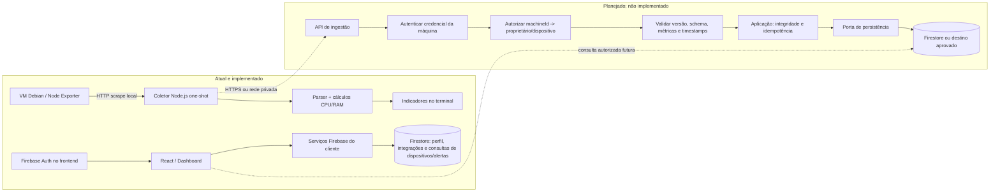

# Contrato de dados de métricas

> **Status:** a implementação desta etapa está descrita em [monitoring-collector.md](monitoring-collector.md) e nos endpoints `api/collector/`. O contrato de exemplo abaixo é uma proposta histórica e foi supersedido pelo schema runtime versionado no código. A existência dos endpoints no workspace não confirma deployment, Rules, TTL ou acesso ao Firebase de produção.

## Contrato implementado nesta etapa

- Envelopes versionados `schemaVersion: 1`, `operation: success|error`, `sampleId` UUID, `integrationId`, `deviceId` e timestamp ISO UTC.
- Sucesso transporta percentuais CPU/RAM, bytes RAM, até 32 filesystems deduplicados e counters/taxas de rede; falha transporta apenas mensagem operacional sanitizada.
- `userId` é proibido no corpo. O servidor deriva UID da credencial do coletor, que é emitida após verificar o Firebase ID token e a propriedade do documento de integração.
- Payload máximo: 64 KiB. Timestamp aceito até 10 minutos no passado e 1 minuto no futuro. Cada identidade pode gravar no máximo uma tentativa a cada 15 segundos.
- Persistência no caminho atual `users/{uid}/devices/{deviceId}/metrics/{sampleId}`; `sampleId` também torna retries idempotentes. Documentos têm `isDemoData: false`, `source: node_exporter` e TTL de 90 dias via `expiresAt`.
- Token de 256 bits; Firestore guarda HMAC com `COLLECTOR_TOKEN_PEPPER`, token expira em 90 dias e rotação remove o hash anterior.
- Testes em memória cobrem autenticação, ownership, schema, envio válido, falha operacional e idempotência. Eles não substituem teste com Firestore Emulator nem validação ponta a ponta após configuração/deploy.

O documento abaixo continua útil como histórico de decisões e contexto, mas não como contrato normativo.

## 1. Contexto confirmado

- O coletor em `collector/` executa uma coleta one-shot fora do navegador. `collector/src/collect.ts` consulta duas vezes o Node Exporter; `collector/src/metrics.ts` calcula percentuais de CPU e memória; `collector/src/cli.ts` imprime timestamp e indicadores.
- O resultado atual do coletor tem `collectedAt`, `cpuUsagePercent` e `memoryUsagePercent`. Não contém identificador de máquina nem os valores brutos de memória, e não é enviado a um serviço.
- `src/types/index.ts` contém `Device`, `MetricPayload`, `CpuMetric` e `MemoryMetric`. `MetricPayload` prevê disco e rede; o histórico do Dashboard consulta `users/{uid}/devices/{deviceId}/metrics`.
- `src/services/integrationService.ts` grava configurações em `users/{uid}/integrations`. `src/services/deviceService.ts` observa/exclui `users/{uid}/devices`. `src/services/dashboardService.ts` lê essa subcoleção. Não foi encontrado serviço de ingestão de métricas.
- `src/services/config.tsx` inicializa Firebase no cliente; `src/contexts/AuthProvider.tsx` observa a sessão Firebase Auth. Não foram encontradas regras Firestore versionadas no repositório, e a autorização efetiva implantada é desconhecida.
- O Dashboard lê amostras persistidas no caminho por dispositivo e oferece seed manual, identificado e idempotente para demonstração. O coletor continua sem persistência ou integração com esse fluxo. Relatórios e parte da tela de métricas ainda contêm dados ou comportamentos simulados.

Esses fatos descrevem o código examinado, não a configuração de produção. A VM Debian e o endpoint local são contexto de desenvolvimento; não devem ser embutidos como configuração universal nem expostos publicamente.

### Observações de ambiente fornecidas pelo desenvolvedor

O desenvolvedor relata Vercel Hobby em conta pessoal, sem cobrança ativa observada e região `iad1`; Firebase Spark, Firestore `nam5`, coleção `users` existente e quotas mostradas nos painéis. São observações fornecidas, não confirmação independente dos termos oficiais atuais. Os números de invocações, duração, transferência e quotas não foram incluídos nesta solicitação. Não inferir que Hobby/Spark impliquem operação gratuita para qualquer uso futuro.

## 2. Envelope proposto

O contrato HTTP deve ser versionado e estrito. Proposta de corpo de ingestão para uma amostra:

```json
{
  "schemaVersion": 1,
  "sampleId": "<UUID da amostra>",
  "machineId": "<identificador registrado da máquina>",
  "collectedAt": "2026-10-28T12:34:56.000Z",
  "metrics": {
    "cpu": {
      "usagePercent": 8.18
    },
    "memory": {
      "totalBytes": 16777216000,
      "availableBytes": 7822370816,
      "usagePercent": 53.38
    }
  }
}
```

| Campo | Tipo proposto | Semântica e validação |
|---|---|---|
| `schemaVersion` | inteiro | Versão do envelope. O receptor rejeita versões não suportadas; alterações incompatíveis exigem nova versão. |
| `sampleId` | UUID | Identificador criado uma vez para a amostra lógica e reutilizado em retries. Não é credencial nem prova de autorização. |
| `machineId` | ID opaco registrado | Identifica o dispositivo dentro do vínculo de uma credencial. Não deve ser IP, hostname nem autorização autossuficiente. |
| `collectedAt` | string RFC 3339/ISO 8601 em UTC | Instante da coleta informado pelo coletor. Deve ser parseável e passar a política de desvio de relógio. |
| `metrics.cpu.usagePercent` | número finito | Percentual derivado dos deltas de duas amostras do Node Exporter. Intervalo inclusivo de 0 a 100. |
| `metrics.memory.totalBytes` | inteiro seguro em bytes | Memória total positiva observada no Node Exporter. |
| `metrics.memory.availableBytes` | inteiro seguro em bytes | Memória disponível observada; deve estar entre zero e `totalBytes`. |
| `metrics.memory.usagePercent` | número finito | Percentual derivado dos valores em bytes; o servidor deve recalcular e persistir o valor canônico. |

O tipo conceitual TypeScript (ainda não implementado) poderia ser:

```ts
interface MetricsSampleV1 {
  schemaVersion: 1;
  sampleId: string;
  machineId: string;
  collectedAt: string;
  metrics: {
    cpu: { usagePercent: number };
    memory: {
      totalBytes: number;
      availableBytes: number;
      usagePercent: number;
    };
  };
}
```

Esse tipo apenas documenta a proposta. Tipos TypeScript não substituem validação runtime. A API deve rejeitar propriedades desconhecidas, dados malformados e tipos incompatíveis antes de invocar persistência. `userId` e `persistedAt` não pertencem ao corpo confiável do coletor: o servidor deriva a propriedade da identidade autenticada e cria o timestamp de persistência.

Este envelope descreve uma amostra individual. Para o cenário proposto de cinco amostras por máquina por lote, a API poderá receber um invólucro com uma lista desses envelopes, preservando um `sampleId` idempotente por amostra. A estrutura exata do lote, o limite de bytes e a atomicidade (lote inteiro ou amostras independentes) ainda não foram decididos nem implementados.

### Timestamp de coleta e persistência

`collectedAt` representa quando o coletor concluiu a amostra usada no cálculo. O coletor atual define seu timestamp ao produzir o resultado; ele não preserva os timestamps Prometheus recebidos.

O registro persistido deve acrescentar `persistedAt`, preenchido exclusivamente por timestamp de servidor/Firestore no commit. Assim é possível medir atraso entre coleta e gravação. Não aceite esse campo do remetente. Um campo `receivedAt` separado só deve ser adicionado se uma fila ou processamento assíncrono futuro exigir medir separadamente recepção e commit; não é necessário para o fluxo síncrono mínimo.

## 3. Regras de métricas

### CPU

`usagePercent` significa a proporção agregada de tempo não ocioso em todas as CPUs durante o intervalo entre dois scrapes. A origem é `node_cpu_seconds_total`, agrupado por `cpu` e `mode`; deltas negativos, reinícios ou séries ausentes tornam a amostra inválida, como já ocorre no cálculo local.

Faixa proposta: `0 <= usagePercent <= 100`. O coletor calcula o valor em ponto flutuante; a CLI atual apenas formata a exibição com duas casas. Para persistência, recomenda-se normalizar para duas casas decimais. Essa precisão é uma decisão de contrato ainda não aprovada. Valor ausente, `NaN`, infinito, texto, abaixo de zero ou acima de 100 deve ser rejeitado, nunca convertido em zero.

O servidor não consegue reconstruir o delta a partir somente do percentual. A ingestão autenticada confia nesse indicador calculado pelo coletor, mas valida tipo/faixa e associa a origem à máquina registrada. Se for necessário auditoria/recalcular CPU no servidor, será preciso aprovar um contrato diferente que também transporte deltas brutos e intervalo; esses dados não são propostos agora.

### Memória

Origem: `node_memory_MemTotal_bytes` e `node_memory_MemAvailable_bytes`.

```text
Memória utilizada (%) = ((MemTotal - MemAvailable) / MemTotal) × 100
```

Invariantes antes da persistência:

1. `totalBytes` e `availableBytes` são números inteiros não negativos e seguros para a representação escolhida; `totalBytes > 0`.
2. `0 <= availableBytes <= totalBytes`.
3. O servidor recalcula `usagePercent` a partir dos bytes e persiste o resultado canônico; recomenda-se rejeitar se o valor enviado diferir além de uma tolerância definida (proposta: 0,01 ponto percentual).
4. O resultado deve ser finito e pertencer a `[0, 100]`.
5. Se qualquer métrica obrigatória estiver ausente ou inválida, rejeitar a amostra inteira. Não persistir CPU válida junto com memória inválida como se fosse uma coleta completa.

A tolerância de arredondamento depende da precisão aprovada e ainda exige decisão.

## 4. Identidade e autorização

### Recomendação de associação

Usar um identificador opaco estável de máquina registrado previamente no backend e associado a um dispositivo existente em `users/{uid}/devices/{machineId}` (ou ao modelo substituto que venha a ser aprovado). No cadastro/enrollment, uma credencial de máquina fica vinculada no servidor a um único par proprietário/dispositivo e, se necessário, a uma integração.

Na ingestão, o backend deve:

1. Autenticar a credencial da origem antes de processar o corpo.
2. Resolver no registro de credenciais o `uid` e o `machineId` autorizados.
3. Confirmar que o dispositivo pertence àquele `uid`, está ativo e que a credencial está vigente/revogável.
4. Comparar o `machineId` do corpo com a identidade vinculada à credencial. O valor enviado pelo remetente não escolhe o proprietário.
5. Construir o caminho de persistência a partir dos dados autorizados do servidor.

`userId` enviado no payload não é prova de identidade. Um `machineId`, UUID de amostra, hostname ou IP também não concede autorização por si só. Usuários só podem consultar dados para os quais tenham autorização efetiva; as regras Firestore publicadas precisam ser verificadas e testadas antes de definir leitura direta pelo frontend. Credenciais privilegiadas, como service account/Admin SDK, nunca devem estar no frontend, no coletor distribuído ou no repositório.

Firestore Security Rules não são herdadas automaticamente por subcoleções. Uma regra que cubra `users/{uid}/devices/{deviceId}` não cobre por si só `users/{uid}/devices/{deviceId}/metrics/{sampleId}`; a regra deve incluir um `match` que cubra o caminho de métricas, ou wildcard recursivo intencional e testado. Rules não filtram consultas: a query do cliente deve satisfazer a regra. Se uma Vercel Function usar Firebase Admin SDK, esse SDK pode ignorar as Rules do cliente; a API deve autenticar a credencial do agente, resolver o vínculo confiável ao proprietário e autorizar antes de persistir.

### Autenticação de ingestão: alternativas em aberto

- Preferível se disponível na infraestrutura: identidade de workload/máquina gerenciada pela plataforma, com escopo mínimo e tokens curtos.
- Alternativa para um coletor local: enrollment autenticado que emite credencial individual por máquina, armazenada fora do repositório em armazenamento protegido do host, com rotação, revogação e escopo somente de ingestão para aquele dispositivo.
- A API pode validar token assinado de curta duração com `audience`, expiração e identidade de máquina, ou mecanismo equivalente. O protocolo concreto depende de onde o backend será hospedado e de como o coletor alcançará esse serviço.

Essas opções são recomendações, não capacidades já implementadas. Não foi encontrado endpoint de ingestão, cadastro seguro de máquina, registro de credenciais ou regra Firestore no código.

## 5. Idempotência e integridade

Recomenda-se criar `sampleId` uma vez para cada amostra lógica e mantê-lo em qualquer retry. A identidade da escrita será `(machineId autenticado, sampleId)`, não somente o `sampleId` enviado no corpo.

O backend valida e normaliza primeiro; depois usa criação condicional/transação no repositório. Se a identidade ainda não existir, cria o registro. Se já existir com o mesmo conteúdo canônico, retorna sucesso idempotente sem nova amostra. Se o mesmo ID vier com conteúdo diferente, rejeita como conflito; não sobrescreve silenciosamente. O conteúdo comparado pode ser um hash determinístico do envelope validado, calculado no servidor, ou comparação dos campos normalizados. Essa escolha e a resposta HTTP exata ficam para o desenho da API.

O coletor atual não gera `sampleId`, não faz envio nem retry; todos esses comportamentos são futuros.

## 6. Estratégia de persistência Firestore

Nenhuma das opções abaixo está implementada para métricas. O padrão atual confirmado para dispositivos é `users/{uid}/devices/{deviceId}`; o comentário em `src/types/index.ts` descreve métricas sob `devices/{deviceId}/metrics`, portanto há divergência que precisa ser resolvida antes da implementação.

### Opção A — Métricas como subcoleção da máquina

```text
users/{uid}/devices/{machineId}/metrics/{sampleId}
```

**Vantagens:** propriedade aparece na hierarquia; consultar intervalo de uma máquina é direto por `collectedAt`; combina com o caminho atual de dispositivos. Regras para leitura do usuário podem conferir o `uid` no caminho. **Custos/limites:** consulta de várias máquinas exige consultas por máquina ou `collectionGroup`, índices adequados e regras de collection group cuidadosamente revisadas. TTL/retention deve ser configurado para a subcoleção e não é automático.

### Opção B — Subcoleção de métricas por usuário

```text
users/{uid}/metrics/{sampleId}
```

Cada documento inclui `machineId`. **Vantagens:** leitura de todo o histórico do usuário é mais simples e a regra por caminho do usuário é explícita. **Custos/limites:** consultas por máquina exigem filtro `machineId` + intervalo de `collectedAt` e índices compostos; o servidor precisa validar a associação máquina-proprietário antes de escrever. Retenção e volume continuam exigindo política e configuração.

### Alternativas ainda sem decisão

Não selecionar um caminho definitivo nesta etapa. A Opção A favorece a leitura temporal de uma máquina; a Opção B mantém amostras diretamente sob `users/{uid}` e exige filtrar pelo `deviceId`. Comparar consultas do Dashboard/relatórios, paginação, índices, regras por caminho, retenção e custo com o número esperado de máquinas antes da escolha. Ambas preservam `users` como raiz e exigem que o servidor valide a associação antes da escrita. Firebase Admin SDK pode ignorar as Rules do cliente; isso não elimina autorização no backend.

Firestore é a única persistência atualmente usada pelo frontend, mas sua adequação econômica para séries temporais, volume esperado, retenção e quotas ainda precisa ser avaliada. O contrato não determina que Firestore seja obrigatoriamente o destino final.

## 7. Ingestão segura sem expor o Node Exporter

O fluxo futuro recomendado é o coletor iniciar uma conexão de saída autenticada para um serviço de ingestão HTTPS ou rede privada/VPN aprovada. O Node Exporter permanece acessível somente na rede local necessária ao coletor; não se abre a porta 9100 à Internet. A API recebe a amostra, autentica a identidade da máquina, autoriza a associação, valida/normaliza o envelope, aplica idempotência e então chama a porta de persistência.

Vercel hospeda a aplicação frontend conforme configuração versionada, mas isso não demonstra que o runtime consiga alcançar `192.168.1.2`. A plataforma de ingestão e a topologia de rede são pendências. Não assumir que o coletor possa enviar direto ao Firestore com credencial privilegiada; não incluir service account no bundle, no coletor ou no Git.

O serviço deve aplicar TLS, autenticação por máquina, escopo mínimo, quotas, logs sem payload/segredos e respostas de erro sem detalhes internos. As regras do Firestore e o método de acesso do frontend devem ser auditados no ambiente efetivo antes de conceder leitura de métricas.

## 8. Limites operacionais propostos

Os números abaixo são **propostas de dimensionamento para cinco máquinas**, não requisitos aprovados nem limites Vercel/Firestore:

| Limite | Proposta inicial | Observação |
|---|---:|---|
| Máquinas simultâneas | 5 | Cenário informado para dimensionamento inicial, não capacidade validada. |
| Intervalo de coleta local | 60 s por máquina | Exigiria execução contínua/buffer; o coletor atual é one-shot manual. |
| Envio periódico | a cada 5 min por máquina | Lote proposto com cinco amostras da mesma máquina; estrutura wire/API ainda não definida. |
| Corpo HTTP | máximo inicial proposto de 16 KiB | Confirmar tamanho real de cinco amostras e limite da plataforma; rejeitar antes do parse se exceder. |
| Amostras por lote | até 5 de uma máquina | Cada amostra mantém seu próprio `sampleId`; atomicidade do lote requer decisão. |
| Desvio de `collectedAt` | até 5 min para trás/frente do relógio servidor | Proposta ainda não aprovada; rejeitar ou colocar em quarentena conforme política futura. |
| Retenção histórica | 7 dias | Proposta do cenário. Precisa de estratégia explícita de TTL/limpeza e verificação de latência/custos; Firestore não foi configurado para expirar esses documentos nesta tarefa. |

Além dos números, exigir `schemaVersion` suportada, timestamp parseável, tamanho máximo de campos, identificadores dentro de formato/tamanho definidos, números finitos, bytes coerentes, idempotência por amostra e rate limit por identidade autenticada. Alertas críticos podem usar uma via imediata mais rápida que o lote, com autenticação/autorização próprias e custos de invocação/gravação adicionais. O fluxo de alerta e os limites finais dependem dos requisitos e orçamento.

Estimativas de volume para **uma gravação de documento por amostra**, no cenário de cinco máquinas:

| Métrica | Cálculo | Estimativa |
|---|---|---:|
| Amostras por máquina/dia | 86.400 s ÷ 60 s | 1.440 |
| Amostras para cinco máquinas/dia | 1.440 × 5 | 7.200 |
| Amostras/documentos criados em 30 dias | 7.200 × 30 | 216.000 |
| Documentos de amostra retidos em estado estável após sete dias | 7.200 × 7 | 50.400 |
| Requisições por máquina/dia com lote de cinco minutos | 1.440 min ÷ 5 min | 288 |
| Requisições para cinco máquinas/dia | 288 × 5 | 1.440 |
| Invocações em 30 dias com lote | 1.440 × 30 | 43.200 |
| Invocações em 30 dias enviando cada amostra individualmente | 7.200 × 30 | 216.000 |

São estimativas aritméticas, não quotas ou custos observados. O desenvolvedor relata limite Vercel de 100.000 invocações e cota Firestore de 20.000 gravações/dia, mas os valores/períodos não foram verificados independentemente. Se 100.000 for um limite mensal aplicável, 216.000 invocações no envio a cada minuto excederiam o relato em 116.000 (2,16×); 43.200 no envio a cada cinco minutos seriam 43,2%, antes de chamadas adicionais. As 7.200 gravações de amostras/dia seriam 36% da cota de 20.000 relatada, antes de alertas e outros writes.

Batch agrupa requisições à API, mas não equivale automaticamente a uma única gravação Firestore: cinco documentos persistidos continuam representando cinco escritas. Os números não incluem gravações auxiliares, alertas, transações, retries, índices, leituras, bytes armazenados ou custos. Não estimar estes itens sem frequência de consultas, usuários ativos, tamanho médio real dos documentos/lotes, índices, retenção e política de exclusão. Confirme condições atuais dos planos, quotas e cobrança antes de assumir custo gratuito.

O estoque de 50.400 amostras pressupõe que a expiração de sete dias realmente esteja operando. Não existe mecanismo de expiração/limpeza confirmado aqui; não presumir exclusão automática. A implementação futura deve escolher e verificar o mecanismo, inclusive exclusão de subcoleções. O coletor atual não mantém amostras entre execuções; coleta a cada minuto e buffer de cinco minutos exigirão processo contínuo e estratégia para reinícios/perda do buffer.

## 9. Fluxo atual e planejado



No fluxo planejado, autenticação e autorização ocorrem antes da lógica de aplicação e persistência. O diagrama não indica conexão atual do coletor com Firestore nem acesso de Vercel à VM privada.

## 10. Arquitetura e responsabilidades para implementação

Manter o coletor atual como produtor de métricas local. Ao introduzir ingestão, uma separação mínima compatível com Clean Architecture seria:

- **Domínio:** contrato versionado e regras puras de coerência/fórmulas; sem imports de Firebase ou HTTP.
- **Aplicação:** caso de uso de ingestão que recebe uma identidade autenticada já validada, verifica associação, valida amostra, resolve repetição e solicita persistência por uma porta/interface.
- **Infraestrutura:** adaptador HTTP para autenticação/entrada, validação de token/credencial, implementação do repositório Firestore e timestamp de servidor.

Começar com módulos pequenos e funções puras existentes/reutilizáveis; não criar microsserviços, fila, factory ou abstrações genéricas sem necessidade comprovada. A infraestrutura concreta e os diretórios futuros não estão decididos.

## 11. Decisões e pendências

### Decisões confirmadas pelo estado atual

- Coletor é local, one-shot, Node.js, sem persistência e sem endpoint de entrada.
- Métricas coletadas atualmente: percentuais de CPU e memória; CPU é calculada a partir de duas amostras.
- Autenticação Firebase e leitura/escrita de alguns dados do frontend existem.
- Dispositivos são consultados em `users/{uid}/devices`; não há regras Firestore no repositório e isso não confirma autorização.
- A porta Node Exporter não deve ser exposta publicamente como solução de conectividade.

### Recomendações, ainda sujeitas a aprovação

- Envelope JSON `schemaVersion: 1`, `sampleId` UUID, `machineId` opaco, `collectedAt` RFC 3339 UTC, CPU percentual e memória em bytes com percentual derivado.
- `persistedAt` exclusivamente do servidor; ownership resolvido a partir da credencial registrada, sem `userId` confiável no corpo.
- Idempotência por identidade autenticada da máquina + `sampleId`; conflito se o mesmo ID representar conteúdo diferente.
- Comparar subcoleção de métricas por dispositivo e subcoleção de métricas por usuário; não aprovar o caminho definitivo até validar consultas, Rules, índices, retenção e custo. O cenário de cinco minutos propõe lote por máquina, mas o formato do lote permanece pendente.
- Valores operacionais numéricos apresentados na seção anterior apenas como propostas iniciais.

### Aprovações necessárias antes de implementar

1. Quem registra/enrola a máquina e como a credencial individual é emitida, armazenada, rotacionada e revogada?
2. Qual infraestrutura hospedará a API e qual rota de rede privada/HTTPS o coletor usará?
3. Opção A ou B de persistência, padrões de consulta e política de collection group/índices?
4. Quem pode consultar métricas (somente proprietário, membros/equipe ou papéis específicos) e quais regras efetivas serão testadas?
5. Aprovar precisão, tolerância de consistência de memória, janela de relógio, frequência, limite de corpo, lote e retenção?
6. O Firestore é requisito acadêmico para séries temporais ou destino inicial sujeito a avaliação de custo/volume?
7. Qual resposta de API deve sinalizar repetição idempotente versus reutilização conflitante de `sampleId`?

### Riscos e mitigação

| Risco | Mitigação proposta |
|---|---|
| Spoofing de `userId`/`machineId` ou acesso entre contas | Resolver proprietário pela identidade autenticada no servidor; validar o dispositivo; regras de leitura testadas para cada usuário. |
| Credencial de máquina vazada | Credenciais individuais, curta duração quando suportada, escopo mínimo, rotação/revogação e armazenamento fora do repositório. |
| IP privado da VM não alcançável pelo serviço | Definir rede/egress ou envio do coletor para ingestão acessível; não expor Node Exporter publicamente nem presumir conectividade Vercel. |
| Payload malformado, antigo ou excessivo | Schema estrito, limites, validação temporal, números coerentes e rejeição antes da persistência. |
| Retry duplicado ou colisão de ID | Chave idempotente composta e criação condicional/transação com conflito para conteúdo divergente. |
| Custo/volume excessivo no Firestore | Definir frequência/retention com dados de dimensionamento; TTL, índices mínimos e acompanhamento de leituras/escritas. |
| Divergência do contrato atual TypeScript/UI | Aprovar schema antes de alterar `MetricPayload`, persistência ou Dashboard; fazer migração coordenada e versionada. |

## 12. Próxima tarefa

**WF-MON-001.3 — Implementar a persistência segura das métricas.** Antes de escrever código, aprovar as decisões de credencial, infraestrutura de rede, ownership, estrutura Firestore, regras e limites. Essa implementação ainda não foi executada por WF-MON-001.3A.