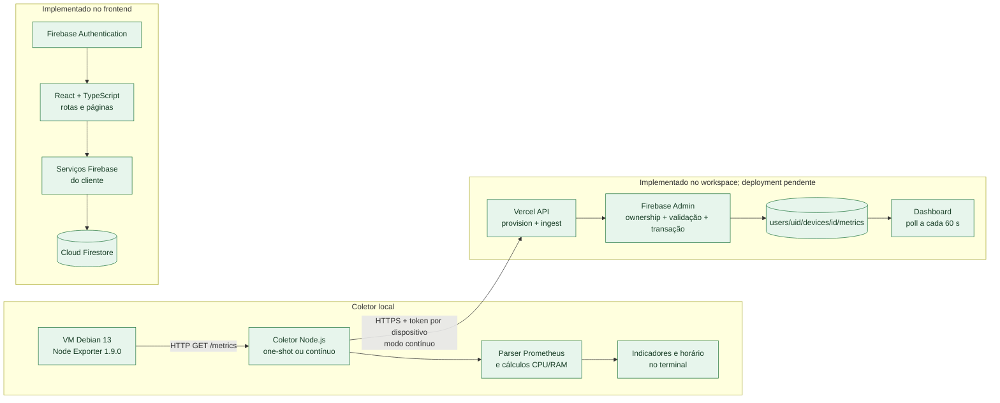

# Visão geral da arquitetura

## Estado e limites

O WatchFlow é um projeto acadêmico de monitoramento de infraestrutura. O estado atual reúne o frontend React/TypeScript, serviços Firebase, o coletor Node.js e funções serverless Vercel para ingestão. O código do pipeline está implementado, mas o deploy e a validação de gravação em Firebase real ainda são operações pendentes.

## Componentes existentes

### Frontend

`src/main.tsx` inicializa a aplicação; `src/App.tsx` envolve a interface com `AuthProvider`; `src/routes/AppRoutes.tsx` define rotas públicas e protegidas. `src/layouts/ProtectedRoute.tsx` controla navegação conforme o estado de autenticação/verificação de e-mail no cliente. Essa guarda de interface não substitui autorização de dados.

As páginas ficam em `src/pages/`: Dashboard, Integrações, Dispositivos, Métricas, Alertas, Relatórios, Perfil, Configurações e Equipe. `src/lib/useDashboard.ts` carrega dados do Dashboard e `src/services/dashboardService.ts` contém consultas desse painel.

### Firebase no frontend

`src/services/config.tsx` inicializa Firebase Auth, Firestore, Storage e Analytics (quando suportado) com variáveis `VITE_FIREBASE_*`. `src/contexts/AuthProvider.tsx` acompanha `onAuthStateChanged`; `src/services/auth.service.ts` implementa os fluxos de autenticação e grava o documento de usuário.

Os serviços atuais leem/escrevem configurações de perfil e integrações. `src/services/integrationService.ts` grava configurações em `users/{uid}/integrations` para o UID autenticado e chama o endpoint de provisionamento para criar uma credencial vinculada a uma integração Node Exporter. O token é exibido uma vez, expira em 90 dias e não é persistido no frontend ou em Firestore como texto.

As funções `api/collector/provision.ts` e `api/collector/ingest.ts` usam Firebase Admin server-side. Provisionamento valida o Firebase ID token e a propriedade de `users/{uid}/integrations/{integrationId}`. Ingestão autentica o token de máquina, valida identidade, schema, timestamp, tamanho e frequência e grava em `users/{uid}/devices/{deviceId}/metrics/{sampleId}`. O Dashboard consulta esse caminho, prioriza amostras reais marcadas `isDemoData: false` e atualiza os dados periodicamente.

Alertas estão na coleção raiz `alerts`; as consultas cliente filtram `userId`. Não foram encontradas regras Firestore no repositório. As regras efetivas implantadas precisam ser verificadas para leitura cliente; o Admin SDK ignora Firestore Rules nas escritas server-side.

`src/types/index.ts` define tipos de usuário, integração, dispositivo, amostra de métrica, alerta, resumo e ponto do Dashboard. São tipos estáticos; não validam documentos Firestore em runtime. A página de Métricas contém histórico demonstrativo, e Relatórios/Configurações têm comportamentos simulados descritos no código.

## Coletor local implementado

O Node Exporter executa em uma VM Debian GNU/Linux 13. No ambiente registrado, a versão observada foi 1.9.0, o endpoint validado foi `http://192.168.1.2:9100/metrics` e a conectividade Windows-VM funcionou. O IP é local e pode mudar; não é uma configuração universal.

O coletor consulta o endpoint, analisa métricas Prometheus, calcula CPU, memória, filesystems e rede. Sem configuração de ingestão faz uma coleta one-shot e imprime JSON; com URL e token configurados roda em ciclo, com retries limitados, e envia as amostras à API. É necessário executá-lo em host da rede local do Node Exporter. A porta 9100 não deve ser exposta publicamente.

O código do pipeline está no workspace, mas a implantação/execução real das funções e a gravação no Firebase ainda não foram validadas. O coletor inicia a conexão de saída; a Vercel não precisa alcançar o IP privado da VM.

## Contratos de dados atuais e lacunas

`src/types/index.ts` define `Device`, `MetricPayload`, `LatestMetricsSummary` e `DashboardMetricPoint`. A API normaliza o resultado para CPU, memory, disk e network usados por `dashboardService.ts`, associa o dispositivo ao UID derivado da credencial e identifica amostras reais com `isDemoData: false`.

Os caminhos persistidos seguem os serviços existentes: integrações em `users/{uid}/integrations`, dispositivo em `users/{uid}/devices/{deviceId}` e métricas em `users/{uid}/devices/{deviceId}/metrics/{sampleId}`. O contrato efetivo e os formatos são documentados em [metrics-data-contract.md](metrics-data-contract.md).

A análise anterior de opções está em [metrics-ingestion-architecture.md](metrics-ingestion-architecture.md); o estado do código/configuração está em [monitoring-collector.md](monitoring-collector.md).

## Segurança e fronteiras

O coletor e a API têm validações próprias documentadas em [monitoring-collector.md](monitoring-collector.md), mas isso não certifica o frontend ou o Firebase como um todo. Não há regras Firestore no repositório, e a leitura pelo cliente depende das regras efetivas publicadas. O endereço do Node Exporter não deve ser exposto publicamente como atalho de integração. A API grava com Firebase Admin, que ignora Security Rules; mantenha a service account somente server-side com permissões mínimas.

## Dependências e ferramentas

O `package.json` declara React 19, TypeScript 6, Vite 8, Firebase 12/Admin, React Router 7, Recharts 3 e Tailwind CSS 4. `npm run collector:test` e `npm run api:test` usam `node:test`; não há configuração de teste de interface. Telegraf e Zabbix podem ser cadastrados como configuração, mas seus coletores não estão implementados.

Há uma configuração ESLint e scripts de build/lint no `package.json`. Uma execução reportada de `npm run lint` encontrou erros em arquivos do frontend fora do coletor; consulte o resultado atual antes de tratar o lint integral como aprovado.