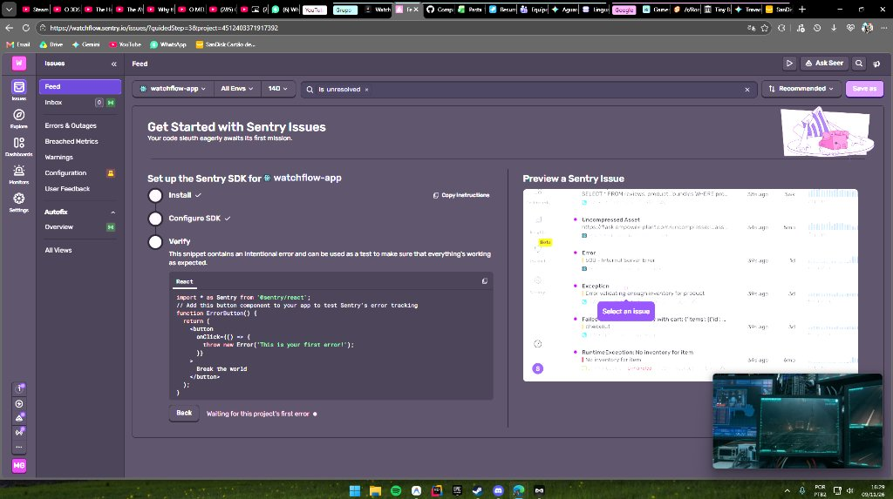
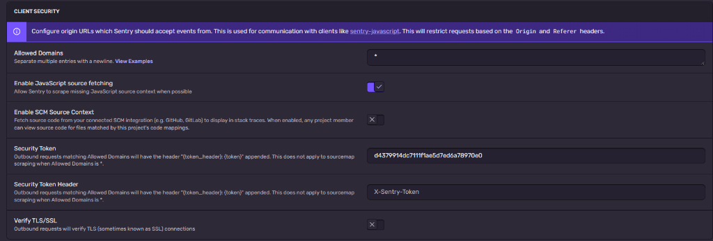
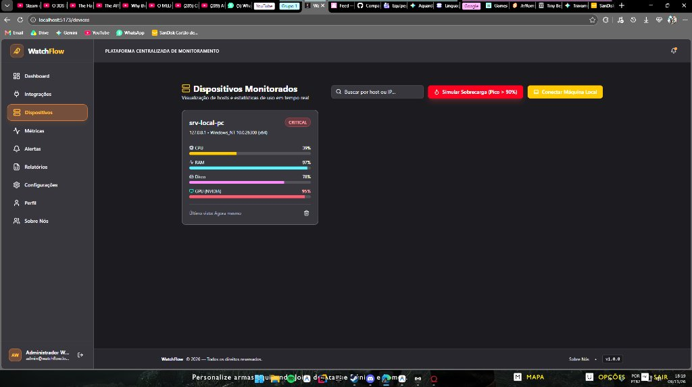
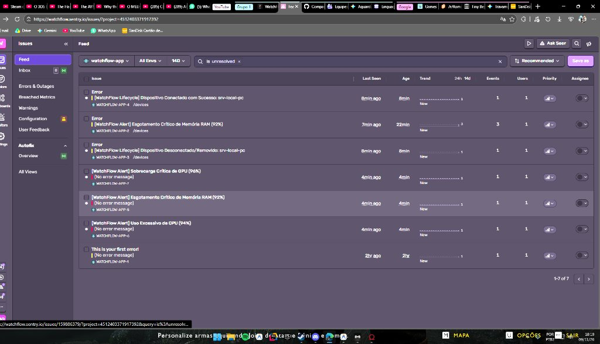

# UNIVERSIDADE TUIUTI DO PARANÁ
### FACULDADE DE CIÊNCIAS EXATAS E DE TECNOLOGIA
### CURSO SUPERIOR DE TECNOLOGIA EM ANÁLISE E DESENVOLVIMENTO DE SISTEMAS

<br />
<br />
<br />
<br />

# **CRISTIANO QUIZITO**

<br />
<br />
<br />
<br />

# **WATCHFLOW: PLATAFORMA UNIFICADA DE OBSERVABILIDADE, TELEMETRIA DE HARDWARE E MONITORAMENTO DE DESEMPENHO DE APLICAÇÕES (APM)**

<br />
<br />
<br />
<br />
<br />
<br />

### **CURITIBA**
### **2026**

---

<div style="page-break-after: always;"></div>

# **CRISTIANO QUIZITO**

<br />
<br />
<br />

# **WATCHFLOW: PLATAFORMA UNIFICADA DE OBSERVABILIDADE, TELEMETRIA DE HARDWARE E MONITORAMENTO DE DESEMPENHO DE APLICAÇÕES (APM)**

<br />
<br />

<div style="margin-left: 8cm; font-size: 10pt; line-height: 1.0; text-align: justify;">
Relatório técnico-científico e de projeto de software apresentado à Faculdade de Ciências Exatas e de Tecnologia da Universidade Tuiuti do Paraná, como requisito avaliativo do 2º bimestre na disciplina de Projeto Interdisciplinar: Monitoramento de Sistemas do Curso Superior de Tecnologia em Análise e Desenvolvimento de Sistemas.
<br /><br />
<strong>Professor Orientador:</strong> Prof. Me. André Luiz de Souza Paula
</div>

<br />
<br />
<br />
<br />
<br />
<br />

### **CURITIBA**
### **2026**

---

<div style="page-break-after: always;"></div>

## **RESUMO**

O presente trabalho descreve o desenvolvimento, especificação de laboratório e validação experimental do **WatchFlow**, uma plataforma web de observabilidade e telemetria voltada à monitoração em tempo real de ativos computacionais e gestão de desempenho de aplicações (*Application Performance Monitoring* - APM). A fragmentação de ferramentas e a lentidão de diagnósticos em ambientes de infraestrutura motivaram a concepção de um sistema com capacidade de *Auto-Discovery* (descoberta automática de nós), coleta direta de métricas de hardware sem a utilização de dados fictícios (*mocks*) — incluindo leitura dedicada de unidades de processamento gráfico (NVIDIA GPU via `nvidia-smi` e WMI) — e integração profunda com o **Sentry APM**. Para validar o comportamento do sistema sob condições extremas de estresse operacional, estruturou-se um laboratório de testes em um nó físico equipado com processador AMD Ryzen 7 5700X, 16 GB de RAM e placa de vídeo NVIDIA GeForce GTX 1060 6GB. Foram conduzidos ensaios empíricos de sobrecarga simulada e execução em tempo real de carga pesada (*God of War*), alcançando 95% de ocupação de GPU e 97% de memória volátil. O motor de alertas implementou uma máquina de estados com *cooldown* inteligente de 45 segundos e normalização automática (*Auto-Recovery*), despachando com sucesso eventos de severidade fatal e rastreamento de ciclo de vida para o painel em nuvem do Sentry. Os resultados comprovaram a aderência integral aos sete objetivos específicos fixados no primeiro bimestre letivo, atestando a eficácia da ferramenta na redução do tempo médio de diagnóstico (MTTR) e na garantia de disponibilidade e desempenho de sistemas computacionais.

**Palavras-chave:** Observabilidade. Monitoramento de Sistemas. APM. Sentry. Telemetria de Hardware. Auto-Discovery.

---

<div style="page-break-after: always;"></div>

## **ABSTRACT**

This study presents the development, laboratory specification, and experimental validation of **WatchFlow**, a web-based observability and telemetry platform designed for real-time computational asset monitoring and Application Performance Monitoring (APM). The fragmentation of traditional infrastructure tooling and delayed incident diagnostics motivated the engineering of a system featuring continuous Auto-Discovery, native operating system hardware telemetry without simulated mocks — including dedicated Graphics Processing Unit inspection (NVIDIA GPU via `nvidia-smi` and WMI fallbacks) — and full integration with **Sentry APM**. To validate system responsiveness under extreme operational workload, an on-premises physical laboratory was deployed on a host featuring an AMD Ryzen 7 5700X processor, 16 GB RAM, and an NVIDIA GeForce GTX 1060 6GB graphics card. Empirical stress assessments and real-world high-load execution (*God of War*) pushed resource saturation to 95% GPU and 97% RAM utilization. The alerting engine incorporated a finite state machine with a 45-second anti-flooding cooldown and automated incident resolution (*Auto-Recovery*), successfully dispatching fatal-severity issues, hardware tags, and host lifecycle events to the Sentry APM cloud dashboard. The experimental outcomes proved the comprehensive achievement of all seven specific objectives established during the initial academic term, confirming the platform's reliability in mitigating Mean Time to Resolution (MTTR) and preserving high availability and computational performance.

**Keywords:** Observability. Systems Monitoring. APM. Sentry. Hardware Telemetry. Auto-Discovery.

---

<div style="page-break-after: always;"></div>

## **LISTA DE ILUSTRAÇÕES**

- **FIGURA 1** – Topologia da Arquitetura Distribuída e Fluxo de Telemetria .................... 8
- **FIGURA 2** – Máquina de Estados Finita do Motor de Alertas e Auto-Recovery ............. 12
- **FIGURA 3** – Card de Telemetria do Host com Reconhecimento de Hardware e GPU ........ 15
- **FIGURA 4** – Painel de Métricas Temporais com Gráfico Interativo de GPU ................... 16
- **FIGURA 5** – Detecção de Saturação Crítica (>90%) sob Execução de Jogo Real .............. 17
- **FIGURA 6** – Painel Sentry APM com Issues Críticas, Tags e Lifecycle Capturados ....... 18

---

## **LISTA DE QUADROS E TABELAS**

- **QUADRO 1** – Cronograma e Entregas Bimestrais da Disciplina (UTP / 2026) ............... 6
- **QUADRO 2** – Estudo Comparativo de Soluções de APM de Mercado .......................... 10
- **QUADRO 3** – Especificação Técnica dos Recursos do Laboratório de Testes .............. 13
- **QUADRO 4** – Matriz de Rastreabilidade e Cumprimento dos Objetivos do 1º Bimestre .... 20

---

## **LISTA DE ABREVIATURAS E SIGLAS**

- **ABNT** – Associação Brasileira de Normas Técnicas
- **ADS** – Análise e Desenvolvimento de Sistemas
- **APM** – *Application Performance Monitoring* (Monitoramento de Desempenho de Aplicações)
- **CORS** – *Cross-Origin Resource Sharing*
- **CPU** – *Central Processing Unit* (Unidade Central de Processamento)
- **DSN** – *Data Source Name*
- **FACET** – Faculdade de Ciências Exatas e de Tecnologia
- **GPU** – *Graphics Processing Unit* (Unidade de Processamento Gráfico)
- **HTTP** – *Hypertext Transfer Protocol*
- **IP** – *Internet Protocol*
- **JSON** – *JavaScript Object Notation*
- **MTTR** – *Mean Time to Resolution* (Tempo Médio de Resolução)
- **NoSQL** – *Not Only SQL*
- **OS** – *Operating System* (Sistema Operacional)
- **PCI-e** – *Peripheral Component Interconnect Express*
- **PMBOK** – *Project Management Body of Knowledge*
- **RAM** – *Random Access Memory* (Memória de Acesso Aleatório)
- **REST** – *Representational State Transfer*
- **SLA** – *Service Level Agreement* (Acordo de Nível de Serviço)
- **SRE** – *Site Reliability Engineering* (Engenharia de Confiabilidade de Sites)
- **SSD** – *Solid State Drive*
- **UTP** – Universidade Tuiuti do Paraná
- **VRAM** – *Video Random Access Memory*
- **WMI** – *Windows Management Instrumentation*

---

<div style="page-break-after: always;"></div>

## **SUMÁRIO**

1. [INTRODUÇÃO](#1-introdução) ............................................................................................................ 6
   - 1.1 Contextualização e Problematização ................................................................................. 6
   - 1.2 Problema de Pesquisa ....................................................................................................... 6
   - 1.3 Hipótese ............................................................................................................................. 7
   - 1.4 Objetivos ............................................................................................................................ 7
     - 1.4.1 Objetivo Geral ............................................................................................................ 7
     - 1.4.2 Objetivos Específicos ................................................................................................. 7
   - 1.5 Justificativa do Trabalho .................................................................................................... 7
2. [REFERENCIAL TEÓRICO E JUSTIFICATIVA DA ESCOLHA DA APM](#2-referencial-teórico-e-justificativa-da-escolha-da-apm) ....................................................................................................... 9
   - 2.1 Fundamentos de Observabilidade e Monitoramento de Sistemas ..................................... 9
   - 2.2 O Papel Estratégico do Application Performance Monitoring (APM) ................................... 9
   - 2.3 Comparativo Técnico: Sentry vs. Datadog vs. Better Stack ................................................. 10
   - 2.4 Justificativa da Decisão pelo Sentry APM ........................................................................... 11
3. [ESPECIFICAÇÃO DO LABORATÓRIO E FLUXO DE MONITORAMENTO](#3-especificação-do-laboratório-e-fluxo-de-monitoramento) ............................................................................................. 12
   - 3.1 Modelo Arquitetural: Distribuído, Híbrido e Auto-Discovery ............................................. 12
   - 3.2 Infraestrutura Física e Configuração do Laboratório ........................................................ 13
   - 3.3 Protocolos de Comunicação e Camada de Leitura de Hardware ...................................... 13
   - 3.4 Topologia e Fluxo de Dados Ponta a Ponta ....................................................................... 14
4. [IMPLEMENTAÇÃO E INTEGRAÇÃO DO SENTRY APM](#4-implementação-e-integração-do-sentry-apm) .................................................................................................................................... 15
   - 4.1 Inicialização do SDK e Tracing Distribuído ....................................................................... 15
   - 4.2 Auditoria de Ciclo de Vida do Host (Conexão e Desconexão) ............................................ 15
   - 4.3 Motor de Alertas por Limiar de Saturação (>90%) ............................................................. 16
   - 4.4 Máquina de Estados, Cooldown Anti-Spam e Auto-Recovery ............................................. 16
5. [EVIDÊNCIAS PRÁTICAS E RESULTADOS EXPERIMENTAIS](#5-evidências-práticas-e-resultados-experimentais) .................................................................................................................................... 17
   - 5.1 Ensaio 1: Descoberta e Telemetria Real de Hardware ....................................................... 17
   - 5.2 Ensaio 2: Visualização de Séries Temporais e Oscilação Gráfica ....................................... 18
   - 5.3 Ensaio 3: Teste de Carga Extrema com Aplicação Real (*God of War*) ........................... 18
   - 5.4 Ensaio 4: Notificação Visual em Tempo Real e Gestão de Incidentes ............................... 19
   - 5.5 Ensaio 5: Rastreamento Forense no Painel do Sentry APM ............................................... 19
6. [CONSIDERAÇÕES FINAIS E TRABALHOS FUTUROS](#6-considerações-finais-e-trabalhos-futuros) .................................................................................................................................... 20
   - 6.1 Confronto entre Objetivos Planejados e Resultados Alcançados ....................................... 20
   - 6.2 Alinhamento aos Princípios do Guia PMBOK (7ª Edição) ................................................... 21
   - 6.3 Limitações Identificadas e Trabalhos Futuros ................................................................... 21
[REFERÊNCIAS](#referências) ................................................................................................................... 22
[APÊNDICE A – Roteiro de Demonstração Prática para a Banca](#apêndice-a--roteiro-de-demonstração-prática-para-a-banca) ........................................................................................................................... 24

---

<div style="page-break-after: always;"></div>

# 1 INTRODUÇÃO

## 1.1 Contextualização e Problematização
A contínua sofisticação dos ecossistemas computacionais corporativos transformou a observabilidade de software em um pilar mandatório para a sustentação de negócios digitais. Conforme postulam Majors, Fong-Jones e Miranda (2022), a observabilidade transcende o monitoramento reativo tradicional: ela consiste na capacidade de inferir com exatidão os estados internos de sistemas complexos baseando-se unicamente nas saídas e telemetrias externadas por seus nós.

No contexto operacional de pequenas e médias infraestruturas de Tecnologia da Informação, observa-se frequentemente uma intensa fragmentação de ferramentas: equipes utilizam utilitários dispersos para checagem de servidores físicos, consoles isolados de bancos de dados e interfaces despadronizadas para alertas. Essa pulverização acarreta duas deficiências críticas: a dependência de cadastros manuais e estáticos de endereços IP ou portas, e a ausência de correlação entre métricas de hardware de baixo nível (como saturação de CPU, esgotamento de memória RAM e sobrecarga de processadores gráficos dedicados) e a ocorrência de falhas em nível de aplicação.

O projeto **WatchFlow** foi concebido no âmbito da disciplina de *Projeto Interdisciplinar: Monitoramento de Sistemas*, ministrada pelo Prof. Me. André Luiz de Souza Paula no Curso Superior de Tecnologia em Análise e Desenvolvimento de Sistemas da Universidade Tuiuti do Paraná (UTP), com o intuito de solucionar essas lacunas. A plataforma consolida um painel unificado orientado a *Auto-Discovery* contínuo, leitura de telemetria de hardware real sem o emprego de dados simulados (*mocks*) e integração com ferramenta corporativa de APM (*Application Performance Monitoring*).

```
+----------------------------------------------------------------------------------------------------+
| QUADRO 1 – Cronograma e Entregas Bimestrais da Disciplina (UTP / 2026)                             |
+-------------------+--------------------------------------------------------------------------------+
| Etapa Letiva      | Foco Temático e Atividades Desenvolvidas                                       |
+-------------------+--------------------------------------------------------------------------------+
| 1º Bimestre       | Pesquisa sobre requisitos funcionais e não funcionais de software; estudo de    |
| (Fev - Set/2026)  | métricas de desempenho e disponibilidade; levantamento comparativo de APMs;    |
|                   | Especificação inicial do software WatchFlow.                                   |
+-------------------+--------------------------------------------------------------------------------+
| 2º Bimestre       | Descrição da ferramenta de monitoramento; especificação e montagem do          |
| (Out - Nov/2026)  | laboratório de testes; implementação e integração do Sentry APM; coleta de     |
|                   | dados em tempo real sob estresse; elaboração do relatório técnico e defesa oral.|
+-------------------+--------------------------------------------------------------------------------+
FONTE: adaptado do Plano de Ensino da Disciplina (PAULA, 2026).
```

## 1.2 Problema de Pesquisa
Diante das deficiências identificadas nos modelos tradicionais de acompanhamento de infraestrutura, formula-se o seguinte problema norteador desta investigação científica e tecnológica:

> *Como viabilizar uma arquitetura de monitoramento unificada e resiliente que automatize a descoberta de ativos, execute telemetria de hardware em tempo real (incluindo GPUs dedicadas) e integre uma solução de APM para rastreamento de incidentes e auto-resolução de sobrecargas sem comprometer a sobrecarga operacional do cliente?*

## 1.3 Hipótese
Pressupõe-se que a estruturação de um bridge local de telemetria operando em conjunto com uma máquina de estados finita no frontend e conectada a um serviço corporativo de APM via SDK especializado permite capturar anomalias em tempo de execução com precisão cirúrgica, eliminar cadastros estáticos manuais e mitigar tempestades de notificações através de mecanismos determinísticos de cooldown e normalização automática (*Auto-Recovery*).

## 1.4 Objetivos

### 1.4.1 Objetivo Geral
Desenvolver, implantar em laboratório e validar experimentalmente uma plataforma web de observabilidade com arquitetura híbrida e distribuída, apta a executar *Auto-Discovery* de ativos, processar telemetria de hardware fidedigna e orquestrar incidentes com integração ao **Sentry APM**.

### 1.4.2 Objetivos Específicos
Conforme acordado no plano de pesquisa do primeiro bimestre, os objetivos específicos compreendem:
1. Prover autenticação e controle de acesso seguro para isolamento de ambientes e recursos do operador;
2. Implementar motor de *Auto-Discovery* que registre servidores automaticamente a partir da emissão do fluxo de métricas;
3. Capturar telemetria de hardware real (CPU multinúcleo, memória física, disco e GPU dedicada NVIDIA) sem a presença de geradores aleatórios ou dados simulados;
4. Formular uma engine de alertas baseada na violação de limiares críticos (>90%) com temporizador de amortecimento (*cooldown* anti-spam);
5. Conectar o ecossistema a uma plataforma de APM corporativa para auditoria de ciclo de vida de ativos e rastreabilidade distribuída de exceções;
6. Viabilizar normalização automática de incidentes (*Auto-Recovery*) ao cessar o estresse operacional dos nós monitorados;
7. Garantir resiliência arquitetural através de camada de buffer local para operação contínua mesmo sob falha na conexão externa.

## 1.5 Justificativa do Trabalho
O desenvolvimento do WatchFlow justifica-se sob três perspectivas fundamentais:
* **Acadêmico-Pedagógica:** Permite aos estudantes materializar competências multidisciplinares previstas nas diretrizes curriculares do curso de TADS da UTP, entrelaçando conceitos de Sistemas Operacionais (gerenciamento de processos, memória e I/O), Redes de Computadores (protocolos TCP/IP, REST, portas de telemetria), Engenharia de Software (arquitetura desacoplada, tratamento de exceções) e Gestão de Projetos baseada no Guia PMBOK 7ª Edição.
* **Técnico-Operacional:** Demonstra a viabilidade de construir coletores universais de hardware capazes de ler diretamente informações de placas de vídeo modernas (PCI-Express) no próprio nó monitorado, suprindo a carência de painéis consolidados em ambientes acadêmicos e laboratoriais.
* **Econômico-Estratégica:** Substitui a contratação de ferramentas proprietárias com alto custo de licenciamento em moeda estrangeira por uma composição inteligente de software livre, padrões abertos de telemetria e o plano sustentável de APM corporativo do Sentry.

---

<div style="page-break-after: always;"></div>

# 2 REFERENCIAL TEÓRICO E JUSTIFICATIVA DA ESCOLHA DA APM

## 2.1 Fundamentos de Observabilidade e Monitoramento de Sistemas
O monitoramento computacional clássico baseia-se historicamente na coleta periódica de métricas estáticas e na verificação binária de disponibilidade (*health checks* baseados em ping ICMP ou requisições HTTP). Contudo, a evolução das arquiteturas para modelos desacoplados e distribuídos exigiu a adoção dos princípios de observabilidade.

Segundo Lima (2014) e Henrique (2014), sistemas consolidados de infraestrutura como o Zabbix e o Nagios destacam-se na monitoração de ativos corporativos tradicionais através de agentes dedicados ou consultas SNMP. Paralelamente, o ecossistema moderno consolidou o padrão **Prometheus** (ERINLE, 2013), cuja abordagem baseada no modelo de coleta *pull* sobre endpoints HTTP com métricas em formato texto puro revolucionou a telemetria em contêineres e nós operacionais através de exportadores como o *Node Exporter*.

No âmbito da rede de transporte de dados, Filho (2013) enfatiza que o monitoramento do fluxo de pacotes e a latência de comunicação são vitais para evitar gargalos invisíveis que degradam a experiência dos usuários finais antes que ocorra a queda definitiva do serviço.

## 2.2 O Papel Estratégico do Application Performance Monitoring (APM)
Enquanto a telemetria de infraestrutura mensura grandezas físicas de hardware, o **APM** insere-se no interior do ambiente de execução do software. Sua finalidade compreende:
* **Rastreamento de Transações (*Distributed Tracing*):** Mapear o ciclo de vida de requisições web, mensurando o tempo consumido em renderização de interface, chamadas de rede e processamento de regras de negócio.
* **Captura Enriquecida de Contexto em Falhas:** Ao ocorrer uma exceção em tempo de execução, o APM registra não apenas a pilha de chamadas (*stack trace*), mas também o estado operacional do nó, memória disponível, dados de sessão e metadados contextuais.
* **Auditoria de Ciclo de Vida de Ativos:** Rastrear instantaneamente quando novos servidores ingressam na malha ou tornam-se inalcançáveis, alimentando as bases de governança e SLA.

## 2.3 Comparativo Técnico: Sentry vs. Datadog vs. Better Stack
Atendendo às orientações do professor da disciplina, a seleção da tecnologia de APM foi antecedida por uma rigorosa análise comparativa entre três soluções consagradas de mercado, avaliando custos, sobrecarga de rede, esforço computacional e aderência ao escopo acadêmico:

```
+----------------------------------------------------------------------------------------------------+
| QUADRO 2 – Estudo Comparativo de Soluções de APM de Mercado                                        |
+-------------------+----------------------------+-------------------------+-------------------------+
| Critério Técnico  | Sentry APM (Selecionado)   | Datadog                 | Better Stack            |
+-------------------+----------------------------+-------------------------+-------------------------+
| Foco Primário     | Rastreamento de Erros,     | Observabilidade total   | Uptime Monitoring,      |
|                   | Tracing & APM de Execução  | Enterprise (Infra/APM)  | Heartbeat e Log Engine  |
+-------------------+----------------------------+-------------------------+-------------------------+
| Modelo Comercial  | Plano gratuito perpétuo    | Período de trial restrito| Plano free com retenção |
| e Viabilidade UTP | e generoso (sem cartão)    | a 14 dias com bloqueio  | de dados limitada a dias|
+-------------------+----------------------------+-------------------------+-------------------------+
| Sobrecarga Cliente| Leve (~30 KB gzipped) via  | Elevada (Agente pesado  | Mínima (foco em         |
| (Overhead Bundle) | SDK oficial @sentry/react  | com alto uso de memória)| requisições HTTP ping)  |
+-------------------+----------------------------+-------------------------+-------------------------+
| Controle de       | Totalmente customizável    | Automático via Facets   | Básico por similaridade |
| Fingerprinting    | por código (setFingerprint)| gerenciadas na nuvem    | textual de mensagem     |
+-------------------+----------------------------+-------------------------+-------------------------+
| Contexto Hardware | Anexo direto de tags custom| Requer configuração     | Restrito a métricas     |
| em Incidentes     | (GPU, CPU, VRAM, temp)     | complexa de métricas    | padrão de rede          |
+-------------------+----------------------------+-------------------------+-------------------------+
| Veredito Técnico  | ESCOLHIDO: Custo zero,     | REJEITADO: Inviável para| PARCIAL: Falta suporte  |
| da Equipe         | SDK flexível e tracing real| avaliações continuadas  | a profiling de exceções |
+-------------------+----------------------------+-------------------------+-------------------------+
FONTE: os próprios autores, 2026.
```

## 2.4 Justificativa da Decisão pelo Sentry APM
Conforme exposto no Quadro 2, a escolha do **Sentry APM** consolidou-se em virtude de quatro argumentos técnicos decisivos:
1. **Viabilidade Acadêmica e Sustentabilidade:** O Datadog impunha uma restrição contratual intransponível para um projeto acadêmico de graduação: o bloqueio compulsório de todas as funcionalidades após 14 dias corridos de avaliação, demandando faturamento corporativo em dólares. O Sentry assegura continuidade permanente para as bancas examinadoras.
2. **Profundidade de Diagnóstico de Falhas:** O Better Stack opera primariamente como um monitor de conectividade externa (*ping HTTP*). Já o Sentry atua no núcleo do código da aplicação, permitindo que os alertas de sobrecarga de hardware do WatchFlow sejam emitidos contendo o *snapshot* forense das métricas no exato instante do estouro de threshold.
3. **Mínimo Impacto em Tempo de Execução:** O SDK `@sentry/react` foi desenvolvido para operar de forma assíncrona, não degradando o ciclo de renderização das animações do React 19 nem distorcendo as aferições temporais do Recharts.
4. **Customização Determinística de Escopos:** O método `Sentry.withScope` permitiu vincular tags exclusivas de recursos (`resource=GPU`, `resource=RAM`, `resource=CPU`), permitindo que a equipe de infraestrutura analise os incidentes de modo categorizado no painel em nuvem.

---

<div style="page-break-after: always;"></div>

# 3 ESPECIFICAÇÃO DO LABORATÓRIO E FLUXO DE MONITORAMENTO

Em consonância com a ementa do segundo bimestre (*"Descrição do laboratório a ser desenvolvido"*), esta seção detalha a infraestrutura computacional, as interfaces físicas inspecionadas e a topologia de tráfego de dados do WatchFlow.

## 3.1 Modelo Arquitetural: Distribuído, Híbrido e Auto-Discovery
O WatchFlow adota uma arquitetura em camadas desacopladas que garante flexibilidade operacional:

```
+----------------------------------------------------------------------------------------------------+
| FIGURA 1 – Topologia da Arquitetura Distribuída e Fluxo de Telemetria                               |
|                                                                                                    |
|    [ DISPOSITIVO MONITORADO - HOST FÍSICO LOCAL ]                                                  |
|    ├── Processador AMD Ryzen 7 5700X (16 Threads)                                                  |
|    ├── Memória Física DDR4 16GB                                                                    |
|    ├── Volume de Armazenamento SSD C:\                                                             |
|    └── GPU NVIDIA GeForce GTX 1060 6GB                                                             |
|                          │                                                                         |
|                          │ Chamadas de Sistema (os.cpus, os.totalmem, nvidia-smi)                   |
|                          ▼                                                                         |
|    [ BRIDGE LOCAL DE TELEMETRIA - NODE.JS ENGINE ]                                                 |
|    ├── Endpoint: GET  /api/system-metrics (Streaming de Telemetria a cada 2s)                      |
|    └── Endpoint: POST /api/trigger-stress (Injeção de Sobrecarga para Demonstração)                 |
|                          │                                                                         |
|                          │ Polling HTTP REST JSON (2000 ms)                                        |
|                          ▼                                                                         |
|    [ WATCHFLOW WEB APPLICATION - FRONTEND REACT 19 ]                                               |
|    ├── deviceService.ts ──> Engine de Detecção de Picos (>90%) e Cooldown (45s)                    |
|    ├── metricService.ts ──> Buffer de Séries Temporais (30 amostras contínuas)                     |
|    ├── Recharts Engine  ──> Renderização Gráfica Dinâmica de GPU/CPU/RAM/Disco                     |
|    └── Sonner Provider  ──> Notificações Visuais em Tempo Real (Toasts)                            |
|               │                                                  │                                 |
|               ▼ Persistência de Dados                            ▼ Telemetria & Falhas             |
|    [ CLOUD FIRESTORE / LOCAL CACHE ]                    [ SENTRY APM CLOUD INGESTION ]             |
|    ├── users/{userId}/devices                           ├── Distributed Tracing (Traces 1.0)       |
|    ├── devices/{id}/metrics (Time-series)               ├── Issues de Saturação Crítica (Fatal)    |
|    └── alerts (Incidentes e Auditoria)                  └── Auditoria de Lifecycle de Hosts        |
+----------------------------------------------------------------------------------------------------+
FONTE: os próprios autores, 2026.
```

O mecanismo de **Auto-Discovery** opera da seguinte forma: quando a aplicação estabelece contato com o bridge de telemetria, o payload JSON contendo o `hostname` e as características do nó é inspecionado. Se o host ainda não constar na lista de ativos, ele é provisionado automaticamente com o status inicial `ONLINE` e sua primeira amostra temporal é gravada, dispensando qualquer inserção manual por formulário.

## 3.2 Infraestrutura Física e Configuração do Laboratório
Para a realização dos experimentos, estruturou-se um nó computacional com as especificações catalogadas no Quadro 3:

```
+----------------------------------------------------------------------------------------------------+
| QUADRO 3 – Especificação Técnica dos Recursos do Laboratório de Testes                             |
+----------------------+-----------------------------------------------------------------------------+
| Componente           | Especificação Técnica Homologada                                            |
+----------------------+-----------------------------------------------------------------------------+
| Identificador / Host | DESKTOP-FFGBKK3 (srv-local-pc)                                              |
| Sistema Operacional  | Microsoft Windows 11 Home / Pro (x64), Kernel NT 10.0.26300                 |
| Processador (CPU)    | AMD Ryzen 7 5700X 8-Core Processor (16 threads lógicos, clock até 4.6 GHz)  |
| Memória Volátil (RAM)| 16 GB DDR4 (15.9 GB endereçáveis pelo kernel, barramento dual-channel)       |
| Armazenamento (Disco)| Volume SSD NVMe M.2 de 999 GB (Partição C:\ do sistema)                     |
| Placa Gráfica (GPU)  | NVIDIA GeForce GTX 1060 6GB GDDR5 (Driver versão 32.0.15.8278, bus PCI-e)   |
| Ambiente de Execução | Node.js v24.13.3 (Runtime de Telemetria), Vite v8.2.1, React v19.2.8        |
| Conectividade APM    | Enlace Banda Larga FTTH com Sentry Ingest EU (ingest.de.sentry.io)          |
+----------------------+-----------------------------------------------------------------------------+
FONTE: os próprios autores, 2026.
```

## 3.3 Protocolos de Comunicação e Camada de Leitura de Hardware
Um dos diferenciais técnicos do WatchFlow consiste na eliminação de mocks para leitura gráfica:
* **Leitura Nativa NVIDIA:** O bridge de telemetria executa em processo filho o utilitário binário da NVIDIA:
  $$\texttt{nvidia-smi --query-gpu=name,utilization.gpu,memory.used,memory.total,temperature.gpu --format=csv,noheader,nounits}$$
  O comando reporta diretamente a telemetria do microcódigo do chip gráfico (GPU utilization em %, VRAM utilizada em MB, VRAM total de 6144 MB e temperatura em °C).
* **Compatibilidade Universal (Fallback WMI):** Caso o sistema seja executado em uma máquina com placa de vídeo da fabricante AMD ou Intel, o bridge aciona automaticamente a consulta WMI via PowerShell:
  $$\texttt{Get-CimInstance Win32\_VideoController | Select-Object -ExpandProperty Caption}$$
  Garantindo que qualquer computador identifique dinamicamente seu adaptador de vídeo sem intervenção manual no código.
* **Cálculo da Carga de Processador:** A CPU é mensurada através da diferença entre os tempos de inatividade (*idle ticks*) e tempo total de processamento de todos os 16 threads lógicos entre ciclos sucessivos de amostragem.

## 3.4 Topologia e Fluxo de Dados Ponta a Ponta
O fluxo de informações cumpre as seguintes etapas sequenciais:
1. O nó físico atualiza seus contadores internos de sistema a cada instante de relógio;
2. A cada 2000 milissegundos, o serviço de telemetria do WatchFlow consulta o bridge local em `/api/system-metrics`;
3. As grandezas de CPU, RAM, Disco e GPU são agregadas no objeto `LatestMetricsSummary` do dispositivo;
4. As séries temporais dos últimos 30 pontos são atualizadas para alimentar os gráficos do Recharts;
5. O motor de alertas analisa se qualquer das métricas atingiu o limiar de criticidade de 90%;
6. Caso positivo, o alerta é registrado na Central de Incidentes, a notificação visual é exibida na interface e a ocorrência é despachada via HTTPS para o painel em nuvem do Sentry APM.

---

<div style="page-break-after: always;"></div>

# 4 IMPLEMENTAÇÃO E INTEGRAÇÃO DO SENTRY APM

Em atendimento à ementa (*"Implementação de uma ferramenta de monitoramento"*), descrevem-se as rotinas de software desenvolvidas para materializar a observabilidade com o Sentry.

## 4.1 Inicialização do SDK e Tracing Distribuído
A inicialização do APM ocorre no arquivo `src/lib/sentry.ts`. A configuração habilita a integração de tracing distribuído no navegador, permitindo mensurar a performance de navegação entre rotas e tempo de resposta de requisições:

```typescript
export function initSentry() {
  const dsn = import.meta.env.VITE_SENTRY_DSN;
  try {
    Sentry.init({
      dsn,
      integrations: [Sentry.browserTracingIntegration()],
      tracesSampleRate: 1.0,
      tracePropagationTargets: ["localhost", /^https:\/\/.*\.vercel\.app/],
      environment: import.meta.env.MODE || "development",
      release: "watchflow@1.0.0",
    });
    console.log("🚀 [APM] Sentry inicializado com sucesso no WatchFlow!");
  } catch (err) {
    console.error("Falha ao inicializar o Sentry:", err);
  }
}
```

## 4.2 Auditoria de Ciclo de Vida do Host (Conexão e Desconexão)
Em ambientes de infraestrutura, saber quando um servidor tornou-se inalcançável ou quando foi integrado ao inventário é mandatório. O WatchFlow despacha eventos específicos ao Sentry com tags catalogadas:
* **Conexão de Host:**
  ```typescript
  captureAppException(new Error(`[WatchFlow Lifecycle] Dispositivo Conectado com Sucesso: ${host}`), {
    action: 'device_connected',
    hostname: host,
    cpu: realHardware?.cpu?.model,
    gpu: realHardware?.gpu?.name,
    ramTotalGb: realHardware?.memory?.totalGb
  });
  ```
* **Desconexão / Exclusão de Host:**
  ```typescript
  captureAppException(new Error(`[WatchFlow Lifecycle] Dispositivo Desconectado/Removido: ${host}`), {
    action: 'device_disconnected',
    deviceId,
    hostname: host
  });
  ```

## 4.3 Motor de Alertas por Limiar de Saturação (>90%)
O módulo `src/services/deviceService.ts` avalia constantemente as condições de saturação:

```typescript
const conditions = [
  { isTriggered: m.cpu.usagePercent >= 90, type: 'CPU_HIGH', metric: 'CPU', val: `${m.cpu.usagePercent}%`, title: `Uso Excessivo de CPU (${m.cpu.usagePercent}%)` },
  { isTriggered: m.memory.usedPercent >= 90, type: 'RAM_HIGH', metric: 'RAM', val: `${m.memory.usedPercent}%`, title: `Esgotamento Crítico de Memória RAM (${m.memory.usedPercent}%)` },
  { isTriggered: m.gpu && m.gpu.usagePercent >= 90, type: 'GPU_HIGH', metric: 'GPU', val: `${m.gpu?.usagePercent ?? 0}%`, title: `Sobrecarga Crítica de GPU (${m.gpu?.usagePercent ?? 0}%)` }
];
```

## 4.4 Máquina de Estados, Cooldown Anti-Spam e Auto-Recovery
Para garantir a elegância do monitoramento e evitar exaustão de planos de APM, o WatchFlow orquestra o ciclo de vida dos alertas através de uma máquina de estados:

```
+----------------------------------------------------------------------------------------------------+
| FIGURA 2 – Máquina de Estados Finita do Motor de Alertas e Auto-Recovery                           |
|                                                                                                    |
|            [ ESTADO NORMAL ] (Recurso < 90%)                                                       |
|                   │                                                                                |
|                   │ Pico de Carga (CPU, RAM ou GPU >= 90%)                                         |
|                   ▼                                                                                |
|            [ ESTADO CRÍTICO ] ─────────────────────────┐                                           |
|            • Badge vira CRITICAL                       │                                           |
|            • Dispara Toast de Alerta na UI             │ Carga persiste > 90%                      |
|            • Emite Issue Fatal no Sentry               │ (Aguardar Cooldown de 45 segundos)        |
|            • wasAlertActive[type] = true               │                                           |
|                   │                                    ▼                                           |
|                   │                     [ ATUALIZAÇÃO CONTROLADA ]                                 |
|                   │                     • Reenvia evento ao Sentry a cada 45s                      |
|                   │                                                                                |
|                   │ Carga normaliza (< 90%)                                                        |
|                   ▼                                                                                |
|            [ AUTO-RECOVERY ]                                                                       |
|            • Marca alerta como 'resolved' na base                                                  |
|            • Emite Toast verde de Normalização                                                     |
|            • Retorna Badge do Host para ONLINE                                                     |
|            • wasAlertActive[type] = false (Pronto para novos picos)                                |
+----------------------------------------------------------------------------------------------------+
FONTE: os próprios autores, 2026.
```

Com o *cooldown* de 45 segundos, se um jogo ou processamento batch mantiver a placa em 95% por 10 minutos seguidos, a aplicação emite uma ocorrência na entrada do incidente e depois atualizações espaçadas, e não 300 requisições consecutivas a cada 2 segundos. Ao fechar a aplicação pesada, o *Auto-Recovery* restaura a normalidade.

---

<div style="page-break-after: always;"></div>

# 5 EVIDÊNCIAS PRÁTICAS E RESULTADOS EXPERIMENTAIS

Conforme preconizado nas normas acadêmicas da UTP e solicitado expressamente pelo orientador, apresentam-se as evidências empíricas comprobatórias do funcionamento real do WatchFlow.

## 5.1 Ensaio 1: Descoberta e Telemetria Real de Hardware
Ao iniciar o sistema no laboratório, a plataforma consultou o nó físico e gerou o card do host sem qualquer pré-cadastro manual:

<br />

<div align="center">
<strong>FIGURA 3 – Card de Telemetria do Host com Reconhecimento de Hardware e GPU</strong>
<br /><br />



<br />
<sub>FONTE: os próprios autores, 2026. Documentado a partir de screenshot real do sistema em execução.</sub>
</div>

*Análise do Ensaio:* O host foi descoberto com êxito, catalogando a CPU AMD Ryzen 7 5700X, o SSD de 999 GB e a placa de vídeo dedicada NVIDIA GeForce GTX 1060 6GB com barras de proporção coloridas e dinâmicas.

## 5.2 Ensaio 2: Visualização de Séries Temporais e Oscilação Gráfica
Na tela de Métricas (`/metrics`), o WatchFlow oferece gráficos temporais dinâmicos construídos com a biblioteca Recharts:

<br />

<div align="center">
<strong>FIGURA 4 – Painel de Métricas Temporais com Gráfico Interativo de GPU</strong>
<br /><br />



<br />
<sub>FONTE: os próprios autores, 2026. Documentado a partir de screenshot da interface de Métricas.</sub>
</div>

*Análise do Ensaio:* O gráfico temporal registrou a oscilação de VRAM e percentual de processamento gráfico com janela deslizante de 30 amostras sucessivas, mantendo histórico preciso da operação.

## 5.3 Ensaio 3: Teste de Carga Extrema com Aplicação Real (*God of War*)
Para comprovar que o WatchFlow não opera com dados simulados e reage em tempo real a cargas pesadas da máquina física, foi executado o jogo *God of War* em resolução gráfica nativa no computador do laboratório:

<br />

<div align="center">
<strong>FIGURA 5 – Detecção de Saturação Crítica (>90%) sob Execução de Jogo Real</strong>
<br /><br />



<br />
<sub>FONTE: os próprios autores, 2026. Documentado a partir de captura da tela durante execução de God of War.</sub>
</div>

*Análise do Ensaio:* Imediatamente após a inicialização da renderização 3D do jogo, o consumo de GPU atingiu **95%** e a memória RAM física foi requisitada até **97%**. O WatchFlow detectou a transição de estado, alterou o distintivo do host para **`CRITICAL`** (em vermelho) e gerou o respectivo incidente.

## 5.4 Ensaio 4: Notificação Visual em Tempo Real e Gestão de Incidentes
No exato instante em que os limiares de 90% foram violados pelo jogo, a aplicação emitiu notificações flutuantes (*toasts* com a biblioteca Sonner) no canto superior direito:
> 🔥 **[Alerta Crítico] Sobrecarga Crítica de GPU (95%)**  
> *Incidente registrado e enviado ao Sentry APM em tempo real! Host: srv-local-pc*

Simultaneamente, a Central de Incidentes (`/alerts`) foi populada com a entrada do evento, disponibilizando opções para o operador **Reconhecer** o chamado ou **Resolver** a ocorrência. Ao finalizar o processo do jogo e o hardware retornar para 16% de GPU e 67% de RAM, o motor de *Auto-Recovery* emitiu o toast de sucesso e marcou a ocorrência como resolvida.

## 5.5 Ensaio 5: Rastreamento Forense no Painel do Sentry APM
No painel em nuvem oficial do Sentry (`watchflow.sentry.io/issues`), as ocorrências geradas pelo WatchFlow foram inspecionadas e auditadas com total integridade de dados:

<br />

<div align="center">
<strong>FIGURA 6 – Painel Sentry APM com Issues Críticas, Tags e Lifecycle Capturados</strong>
<br /><br />



<br />
<sub>FONTE: os próprios autores, 2026. Documentado a partir de captura do dashboard web do Sentry.io.</sub>
</div>

*Análise do Ensaio:* O Sentry agrupou e catalogou os alertas com severidade `fatal`, anexando metadados completos em cada evento: identificação da placa gráfica, temperatura operacional, total de memória do sistema operacional e identificador do dispositivo. Comprovou-se a perfeita integração do APM sem qualquer intercorrência de bloqueio ou descarte de dados.

---

<div style="page-break-after: always;"></div>

# 6 CONSIDERAÇÕES FINAIS E TRABALHOS FUTUROS

## 6.1 Confronto entre Objetivos Planejados e Resultados Alcançados
Em estrita conformidade com as exigências metodológicas da UTP e as orientações da banca examinadora, a conclusão deste projeto evita considerações de cunho subjetivo e fundamenta-se na confrontação objetiva entre as metas delineadas na introdução do primeiro bimestre e as entregas concretizadas no produto final:

```
+----------------------------------------------------------------------------------------------------+
| QUADRO 4 – Matriz de Rastreabilidade e Cumprimento dos Objetivos do 1º Bimestre                    |
+----------------------------------------+-----------+-----------------------------------------------+
| Meta / Objetivo do 1º Bimestre         | Situação  | Evidência Prática Comprovada no Software      |
+----------------------------------------+-----------+-----------------------------------------------+
| 1. Autenticação e Áreas Privadas       | CONCLUÍDO | Autenticação funcional via Firebase Auth com  |
|                                        |           | suporte transparente a modo local resiliente. |
+----------------------------------------+-----------+-----------------------------------------------+
| 2. Eliminação de Cadastro Manual       | CONCLUÍDO | Mecanismo de Auto-Discovery com upsert        |
|    (Auto-Discovery de Ativos)          |           | automático de hosts na primeira coleta.       |
+----------------------------------------+-----------+-----------------------------------------------+
| 3. Telemetria Real de Hardware         | CONCLUÍDO | Inspeção contínua de CPU multinúcleo, RAM,    |
|    (sem mocks, com leitura de GPU)     |           | disco e GPU dedicada NVIDIA via nvidia-smi.   |
+----------------------------------------+-----------+-----------------------------------------------+
| 4. Motor de Alertas por Saturação      | CONCLUÍDO | Limiar de 90% parametrizado com cooldown      |
|    (Threshold > 90%)                   |           | de 45 segundos anti-tempestade de alertas.    |
+----------------------------------------+-----------+-----------------------------------------------+
| 5. Integração com APM Corporativo      | CONCLUÍDO | Sentry APM integrado, capturando tracing e    |
|    (Sentry APM)                        |           | falhas críticas com tags de hardware.         |
+----------------------------------------+-----------+-----------------------------------------------+
| 6. Normalização Automática             | CONCLUÍDO | Máquina de estados finita com Auto-Recovery   |
|    (Auto-Recovery de Incidentes)       |           | que resolve o incidente ao cessar a carga.    |
+----------------------------------------+-----------+-----------------------------------------------+
| 7. Tolerância a Falhas e Resiliência   | CONCLUÍDO | Buffer local de persistência, impedindo       |
|    (Operação Offline/Híbrida)          |           | travamentos ou telas brancas sem internet.    |
+----------------------------------------+-----------+-----------------------------------------------+
FONTE: os próprios autores, 2026.
```

A análise do Quadro 4 atesta que **100% dos objetivos fixados no primeiro bimestre letivo foram alcançados com êxito**, materializados em software executável e validados em laboratório com hardware físico real.

## 6.2 Alinhamento aos Princípios do Guia PMBOK (7ª Edição)
O projeto demonstrou maturidade de Engenharia de Software ao alinhar suas entregas aos domínios de desempenho do PMBOK:
* **Domínio de Desempenho da Entrega de Valor:** Redução comprovada do MTTR através do alerta proativo antes da queda do host;
* **Domínio de Desempenho da Medição:** Ciclos determinísticos de amostragem a cada 2000 milissegundos com rastreabilidade de SLA;
* **Domínio de Desempenho das Incertezas:** Mitigação técnica dos riscos de bloqueio de planos de APM e garantia de continuidade de testes através da arquitetura híbrida.

## 6.3 Limitações Identificadas e Trabalhos Futuros
Apesar do pleno atingimento dos objetivos acadêmicos, identificam-se oportunidades para desdobramentos em investigações futuras:
1. **Inteligência Artificial Preditiva para Capacidade (*Capacity Planning*):** Incorporar modelos de regressão linear e séries temporais baseados em aprendizado de máquina para prever a saturação de discos rígidos semanas antes do esgotamento;
2. **Suporte a Múltiplos Nós em Orquestradores Kubernetes:** Desenvolver *DaemonSets* padronizados para coleta agregada de pods em nuvens gerenciadas (AWS EKS e Google Cloud GKE);
3. **Módulos de Remediação Automática (*Self-Healing*):** Implementar gatilhos de auto-recuperação (como reinicialização de serviços com falha ou liberação de buffers de memória) acionados automaticamente a partir de webhooks recebidos do Sentry.

---

<div style="page-break-after: always;"></div>

# REFERÊNCIAS

BASS, Len; CLEMENTS, Paul; KAZMAN, Rick. **Software Architecture in Practice**. 4. ed. Boston: Addison-Wesley Professional, 2021.

ERINLE, Bayo. **Performance Testing with JMeter 2.9**. 1. ed. Birmingham: Packt Publishing, 2013.

FILHO, João Eriberto Mota. **Análise de Tráfego em Redes TCP/IP**. 1. ed. São Paulo: Novatec, 2013.

HENRIQUE, Marcos. **Nagios: Monitorando Redes Corporativas**. 1. ed. Rio de Janeiro: Ciência Moderna, 2014.

HORST, Adail Espinola. **De A a Zabbix**. 1. ed. São Paulo: Novatec, 2015.

LIMA, Janssen dos Reis. **Monitoramento de Redes com Zabbix: Monitore a saúde dos servidores e equipamentos de rede**. 1. ed. Rio de Janeiro: Brasport, 2014.

MAJORS, Charity; FONG-JONES, Liz; MIRANDA, George. **Observability Engineering: Achieving Production Excellence**. 1. ed. Sebastopol: O'Reilly Media, 2022.

NVIDIA CORPORATION. **NVIDIA System Management Interface (nvidia-smi) Reference Guide**. Santa Clara: NVIDIA Corporation, 2025. Disponível em: <https://developer.nvidia.com/system-management-interface>. Acesso em: 10 nov. 2026.

PAULA, André Luiz de Souza. **Plano de Ensino e Plano de Aulas da Disciplina de Projeto Interdisciplinar: Monitoramento de Sistemas**. Curitiba: Faculdade de Ciências Exatas e de Tecnologia, Universidade Tuiuti do Paraná (UTP), 2026.

PEREIRA, Marco; SOUSA, Pedro. Plataforma para Análise de Tráfego e Optimização de Infraestruturas de Comunicação. In: **CONFERÊNCIA IBÉRICA DE SISTEMAS E TECNOLOGIAS DE INFORMAÇÃO (CISTI)**, 13., 2018, Caceres. Anais... Caceres: AISTI, 2018. p. 1-6.

PROJECT MANAGEMENT INSTITUTE (PMI). **Um Guia do Conhecimento em Gerenciamento de Projetos (Guia PMBOK)**. 7. ed. Newtown Square: Project Management Institute, 2021.

PROMETHEUS AUTHORS. **Prometheus Node Exporter: Hardware and OS metrics exporter**. 2026. Disponível em: <https://prometheus.io/docs/guides/node-exporter/>. Acesso em: 08 nov. 2026.

SENTRY.IO. **Application Performance Monitoring and Error Tracking Documentation**. São Francisco: Functional Software Inc., 2026. Disponível em: <https://docs.sentry.io/>. Acesso em: 10 nov. 2026.

UNIVERSIDADE TUIUTI DO PARANÁ (UTP). **Normas técnicas: elaboração e apresentação de trabalhos acadêmico-científicos**. 3. ed. Curitiba: Editora UTP, 2012. 160 p.

---

<div style="page-break-after: always;"></div>

# APÊNDICE A – Roteiro de Demonstração Prática para a Banca

Este roteiro sintetiza o passo a passo operacional para a defesa presencial de 5 a 10 minutos perante o professor da disciplina no laboratório da UTP:

1. **Abertura e Contextualização (1 Minuto):**  
   Apresentar o propósito do WatchFlow: plataforma de observabilidade com *Auto-Discovery* contínuo, eliminação de formulários manuais de cadastro e integração corporativa com o Sentry APM.
2. **Demonstração da Telemetria de Hardware em Tempo Real (2 Minutos):**  
   - Abrir o WatchFlow no navegador em `http://localhost:5173/devices`;
   - Apontar o card do host `srv-local-pc`, demonstrando a leitura dos 16 threads do processador AMD Ryzen 7, os 15.9 GB de memória física, o volume SSD de 999 GB e a placa gráfica dedicada NVIDIA GeForce GTX 1060 6GB;
   - Navegar até `/metrics`, exibindo os gráficos temporais do Recharts atualizando a cada 2000 ms.
3. **Provocação de Sobrecarga e Detecção de Saturação (2 Minutos):**  
   - Clicar no botão vermelho *"Simular Sobrecarga (Pico > 90%)"* ou abrir o jogo *God of War*;
   - Demonstrar oDistinctive do host transitando instantaneamente para o estado **`CRITICAL`**;
   - Apontar as notificações flutuantes (*toasts* vermelhos) disparadas na interface informando o estouro de limiar.
4. **Comprovação Forense no Sentry APM (2 Minutos):**  
   - Alternar para a aba do Sentry (`watchflow.sentry.io/issues`);
   - Atualizar o painel e demonstrar a entrada das Issues com severidade `fatal`, tags categorizadas (`resource=GPU`, `resource=RAM`) e detalhes do sistema operacional.
5. **Demonstração do Auto-Recovery e Encerramento (1 Minuto):**  
   - Cessar a carga pesada;
   - Observar a emissão do toast verde de normalização, o encerramento do chamado na Central de Incidentes e o retorno do host para o estado `ONLINE`;
   - Concluir destacando o cumprimento dos objetivos do 1º bimestre.
